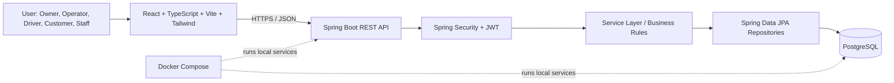
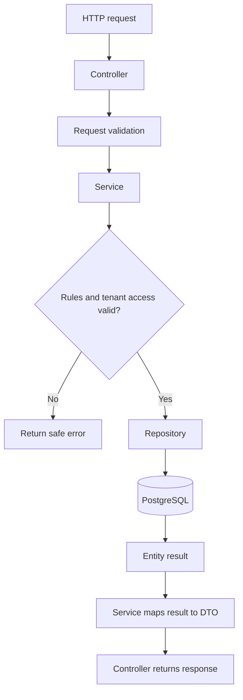
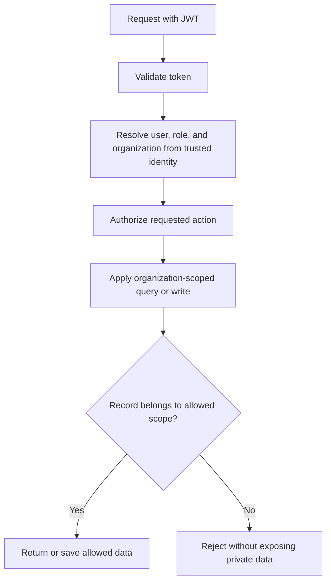
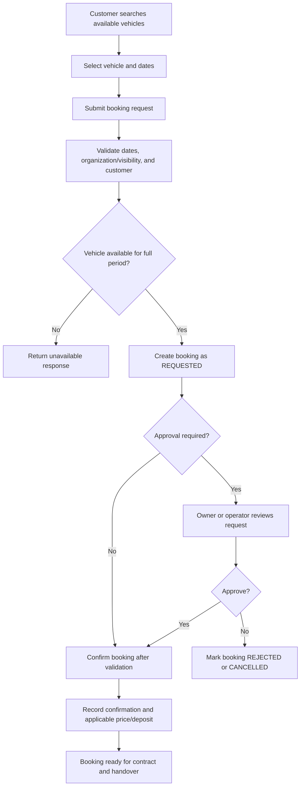
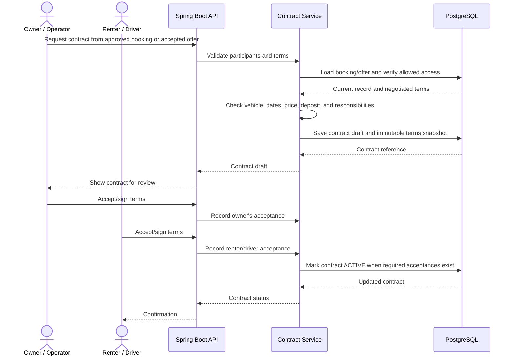
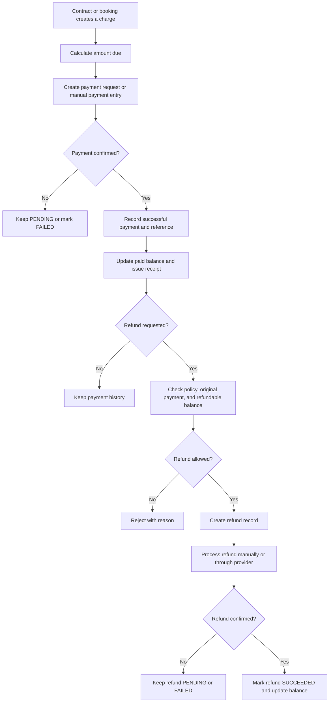
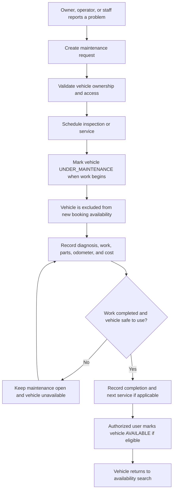
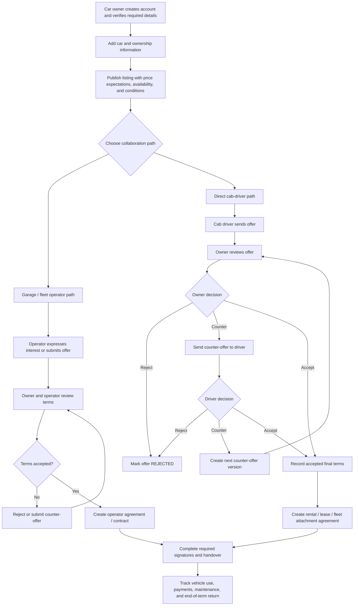

# FleetFlow Architecture

## 1. Project Overview and Goals

FleetFlow is a multi-tenant car rental and fleet management system. It helps car owners, fleet operators, garage businesses, cab drivers, and rental customers manage vehicles and rental work in one place.

The system is designed for more than one organization to use the same application. Each organization has its own users and business records. One organization must not be able to read or change another organization's private data.

Main goals:

- Keep vehicle, customer, booking, contract, payment, refund, and maintenance information in one system.
- Let organizations manage their own fleets and rental operations.
- Let independent car owners list vehicles.
- Support two owner options: offer a vehicle to a garage/fleet operator, or negotiate directly with a cab driver.
- Track offers, counter-offers, acceptances, rejections, and the final agreed terms.
- Check vehicle availability before confirming a booking or agreement.
- Keep financial records clear and traceable.
- Provide dashboards and reports for operational and financial decisions.
- Protect accounts and organization data through authentication, authorization, and tenant isolation.

### Technology stack

| Area | Technology |
|---|---|
| Backend | Java 21, Spring Boot 3.x, Maven |
| Security | Spring Security, JWT |
| Persistence | Spring Data JPA, Hibernate |
| Database | PostgreSQL |
| Frontend | React, TypeScript, Vite, Tailwind CSS |
| Local services | Docker Compose |

This document describes the planned architecture. It does not claim that every module has already been implemented or tested.

## 2. High-Level Architecture

The React application sends HTTPS requests to the Spring Boot REST API. The API authenticates the user, checks permissions and organization scope, applies business rules, and uses repositories to read or write data in PostgreSQL.



### Request lifecycle

1. A user performs an action in the React interface.
2. The frontend sends a request to the API, including the JWT access token when required.
3. Spring Security validates the token and establishes the authenticated user.
4. The backend determines the user's organization and role from trusted server-side identity data.
5. The controller validates the request shape and passes it to a service.
6. The service checks business rules and tenant access.
7. The repository reads or changes the relevant database records.
8. The API returns a response DTO. The frontend displays the result.

The frontend is not a security boundary. All important validation and access checks must also happen on the backend.

## 3. Backend Layers

The backend uses a layered structure. Each layer has a clear responsibility.

| Layer | Responsibility |
|---|---|
| Controller | Exposes REST endpoints, receives requests, applies request-level validation, calls services, and returns HTTP responses. It should not contain core business rules. |
| Service | Implements business rules and workflows, checks permissions and organization scope, coordinates repositories, and defines transaction boundaries. |
| Repository | Uses Spring Data JPA to query and persist entities. Queries must be scoped to the active organization where applicable. |
| Entity | Represents persisted domain data and its relationships. Entities map to PostgreSQL tables. |
| DTO (Data Transfer Object) | Defines request and response shapes for the API. DTOs prevent clients from directly controlling internal entity fields and help avoid exposing sensitive data. |
| Configuration / Security | Configures Spring Security, JWT processing, password hashing, CORS, and application settings. |
| Exception handling | Converts validation, business-rule, authentication, and unexpected errors into consistent API error responses without leaking secrets. |

### Example of a request moving through the layers



### Layering rules

- Controllers should remain thin.
- Services own business decisions, such as booking overlap checks and negotiation transitions.
- Repositories should not be exposed directly to controllers.
- Entities should not be returned as public API responses.
- DTOs should accept only fields that the caller is allowed to set.
- Multi-step changes should use database transactions.
- Important state changes should be validated against the current state before they are saved.

## 4. Multi-Tenancy and Data Isolation

FleetFlow is planned as a shared-database, shared-schema multi-tenant application. Multiple organizations use the same PostgreSQL database, but each organization sees only its own private records.

### Organization ownership

- Every tenant-owned business record must have an `organization_id` (or a documented ownership relationship that resolves securely to one).
- The `organization_id` identifies the organization that owns the record.
- The organization ID must come from trusted authenticated server-side context, not from an untrusted request body or query parameter.
- When creating a tenant-owned record, the backend assigns the active organization ID.
- When reading, updating, or deleting a record, the backend scopes the operation to the active organization.
- Related records must be checked too. A booking must not be able to link a vehicle or customer from a different organization unless an explicitly designed cross-organization relationship permits it.
- Public marketplace listings and negotiations need explicit visibility rules. Public listing details may be discoverable, but private owner, driver, contract, and payment information must remain protected.

### Tenant-isolation flow



### Enforcement requirements

1. **Service-level checks:** Every tenant-sensitive service operation must verify the active organization and record ownership.
2. **Repository scoping:** Prefer repository methods that include the organization ID in the query rather than fetching a record globally and checking it later.
3. **Create-time ownership:** Do not trust a client-supplied `organization_id`. Set it from the authenticated context for normal tenant-owned records.
4. **Relationship validation:** Check tenant ownership of referenced vehicles, customers, bookings, contracts, and other related records.
5. **Role checks:** Tenant membership alone is not enough; the user's role must allow the requested action.
6. **Database constraints:** Use foreign keys, uniqueness constraints, and appropriate indexes. Where useful, use composite constraints that include `organization_id` to help prevent cross-tenant relationships.
7. **Optional defense in depth:** PostgreSQL Row-Level Security (RLS) may be added as a second enforcement layer. If enabled, connection-pool and transaction handling must set and clear tenant context safely.
8. **Testing plan:** Add tests proving that users from Organization A cannot read or modify Organization B's records. Do not treat this planned test coverage as completed until it has actually been run and reviewed.

Platform-level administration, if introduced, must be a deliberate and audited exception. It must not become a general bypass of tenant isolation.

### Marketplace boundary

The owner-to-operator and owner-to-driver marketplace connects different parties. It should not make all records globally visible. A listing can expose approved public fields; an offer should be visible only to its sender, its recipient, and authorized participants. Once accepted, the agreement should preserve the relevant parties and final terms while protecting private data.

## 5. Main Modules

### 5.1 Vehicles

Manages vehicle records, registration details, vehicle specifications, ownership, availability, documents, rental terms, and operational status.

Possible statuses include `DRAFT`, `AVAILABLE`, `RESERVED`, `RENTED`, `UNDER_MAINTENANCE`, and `INACTIVE`. The final enum should be agreed before implementation. Status changes must follow valid transitions rather than arbitrary client updates.

### 5.2 Customers and participants

Stores customer profiles and contact information, along with references to owners, fleet operators/garage businesses, and cab drivers. Authentication accounts and business profiles should be modeled clearly so one person can have the allowed roles without duplicating identity records unnecessarily.

Sensitive identity documents and personal details must have restricted access and must not be returned in general listing responses.

### 5.3 Bookings

Handles booking requests, selected vehicles, requested dates, pickup and return details, pricing estimates, status, and cancellation. Before confirming a booking, the service checks date overlap and vehicle status inside a transaction or with suitable database safeguards to reduce double-booking risk.

Typical statuses: `REQUESTED`, `CONFIRMED`, `CANCELLED`, `IN_PROGRESS`, and `COMPLETED`. The exact state model may be refined during implementation.

### 5.4 Contracts

Stores the final rental or vehicle-use agreement between the relevant parties. It records the agreed dates, price, deposit, usage rules, responsibilities, handover/return condition, and acceptance evidence. Contract terms should be preserved as a snapshot so later changes to a listing do not rewrite an already accepted agreement.

### 5.5 Billing, payments, and refunds

Tracks invoices or charges, deposits, payments, outstanding balances, and refunds. A payment record should include amount, currency, method, status, timestamps, and a provider reference when an external payment provider is used. The initial system may record payments manually before integrating a payment gateway.

Use decimal database types for money, not floating-point types. Store currency explicitly; examples in this document use Indian rupees (₹). Refunds must refer to an original payment or charge, must not exceed the refundable amount, and should be recorded as separate traceable entries rather than silently overwriting payment history.

### 5.6 Maintenance

Tracks service requests, garage/workshop details, issue descriptions, planned service dates, costs, odometer readings, work performed, and completion. Vehicles under active maintenance should normally be unavailable for new bookings until they are marked ready.

### 5.7 Dashboard and reports

Provides role-appropriate summaries such as fleet size, vehicle availability, active bookings, upcoming returns, revenue, outstanding payments, refunds, maintenance costs, and vehicle utilization. Queries must be tenant-scoped. Report definitions should document how figures are calculated and which statuses are included.

### 5.8 Owner listings and negotiation marketplace

Lets an individual or business owner list a car with details such as vehicle type, location, availability, expected price, deposit, usage limits, and conditions. The owner can choose either:

- **Garage/fleet operator route:** Send or receive an interest/offer from a garage or fleet operator that may manage or use the car under agreed terms.
- **Direct cab-driver route:** A cab driver sends an offer, the owner can accept, reject, or counter it, and the driver can accept, reject, or counter again.

Every offer and counter-offer should be stored as a separate history item with its sender, recipient, amount, proposed terms, timestamp, and status. Acceptance should lock the final negotiated terms into an agreement or contract. The exact legal and operational model—rental, lease, or fleet attachment—must be represented explicitly in the agreement type.

## 6. Main Workflows

### 6.1 Booking flow



Key rules:

- Validate start and end dates, including that the end is after the start.
- Prevent overlapping confirmed bookings for the same vehicle.
- Recheck availability at confirmation time, not only when the search results are displayed.
- Apply cancellation and deposit rules consistently.
- Do not expose bookings to unrelated tenants.

### 6.2 Contract flow



Key rules:

- A contract must reference valid participants and the source booking or accepted negotiation, where applicable.
- Record who accepted the agreement and when. A future e-signature integration should retain provider evidence.
- Keep a snapshot of the agreed price, deposit, dates, usage rules, and responsibilities.
- Contract activation must follow the required acceptance policy.
- Changes after activation should use a documented amendment process instead of silently changing the original terms.

### 6.3 Payment and refund flow



Key rules:

- Distinguish a payment request from a confirmed payment.
- Do not mark a gateway payment as successful solely because the browser says so; verify trusted provider confirmation.
- Make payment callbacks idempotent so duplicate notifications do not create duplicate payments.
- A refund is a separate record linked to the original payment.
- Track partial refunds and prevent the total successful refund from exceeding the eligible amount.
- Keep an audit trail of payment and refund status changes.

### 6.4 Maintenance flow



Key rules:

- Maintenance records must belong to the correct organization or permitted owner relationship.
- A vehicle in active maintenance must not be confirmed for an overlapping booking.
- Record costs and service history instead of replacing previous service records.
- Only an authorized role should mark a vehicle ready for use.

### 6.5 Owner listing flow: garage/operator or direct cab-driver negotiation



Negotiation requirements:

- Offers and counter-offers are versioned records; never overwrite the prior proposal.
- Each proposal identifies its sender, recipient, proposed price, deposit, duration, usage limits, and any other relevant terms.
- A proposal can be accepted only while it is still current and open.
- Once a proposal is accepted, close competing active negotiations for the same listing as required by the business rules.
- Revalidate that the vehicle is still eligible and available before creating the final agreement.
- Keep private contact details and documents hidden from unrelated users.
- The garage/operator route and direct-driver route may share the offer engine, but the agreement type must distinguish their legal and operational terms.

## 7. Security Overview

### 7.1 JWT login

1. The user submits login credentials over HTTPS.
2. The backend verifies the password against the stored password hash.
3. If credentials are valid, the backend issues a signed JWT access token with a limited lifetime.
4. The frontend sends the token in the `Authorization: Bearer ...` header for protected API calls.
5. Spring Security validates the token signature, expiry, and relevant claims before allowing access.

Refresh-token behavior, token revocation, and secure token storage must be decided during implementation. Never place JWT signing secrets in frontend code or commit them to source control.

### 7.2 Roles and permissions

Use role-based access control, with permissions limited by organization membership and resource ownership. Planned roles may include:

- `PLATFORM_ADMIN`: platform operations only, with carefully audited cross-tenant capabilities if required.
- `ORG_ADMIN`: manages users and settings within one organization.
- `FLEET_MANAGER` or `GARAGE_OPERATOR`: manages permitted fleet vehicles, bookings, and maintenance.
- `CAR_OWNER`: manages own listings, offers, and agreements.
- `CAB_DRIVER`: searches permitted listings, makes offers, and manages own agreements.
- `CUSTOMER`: manages own profile, bookings, and permitted payments.
- `STAFF` or `FINANCE`: receives only the operational or financial permissions assigned to that role.

The final role names and permissions matrix should be documented before they are implemented. Do not rely on frontend route hiding; enforce permissions in the API and service layer.

### 7.3 Password handling and other protections

- Store passwords only as strong one-way hashes, using Spring Security's `PasswordEncoder` (for example, BCrypt).
- Never log or return passwords, raw tokens, secret keys, or sensitive payment data.
- Validate all incoming data on the backend.
- Use HTTPS outside local development and configure CORS for known frontend origins.
- Use safe error responses and centralized exception handling.
- Protect state-changing endpoints with authorization and appropriate request protections.
- Use environment variables or a secret manager for database credentials and JWT secrets.
- Keep dependencies updated and review access to sensitive identity documents.
- Add audit events for high-impact actions such as role changes, contract acceptance, payments, refunds, and cross-organization administration.

## 8. Planned Folder Structure

The exact names can be adjusted as implementation evolves, but the structure should preserve clear boundaries.

### Backend

```text
backend/
├── pom.xml
├── mvnw
├── mvnw.cmd
└── src/
    ├── main/
    │   ├── java/
    │   │   └── com/fleetflow/
    │   │       ├── FleetFlowApplication
    │   │       ├── config/
    │   │       ├── security/
    │   │       ├── common/
    │   │       │   ├── exception/
    │   │       │   ├── response/
    │   │       │   └── validation/
    │   │       ├── tenancy/
    │   │       ├── auth/
    │   │       ├── organizations/
    │   │       ├── users/
    │   │       ├── vehicles/
    │   │       ├── customers/
    │   │       ├── bookings/
    │   │       ├── contracts/
    │   │       ├── billing/
    │   │       ├── payments/
    │   │       ├── refunds/
    │   │       ├── maintenance/
    │   │       ├── marketplace/
    │   │       │   ├── listings/
    │   │       │   ├── offers/
    │   │       │   └── agreements/
    │   │       └── reports/
    │   └── resources/
    │       ├── application.yml
    │       └── db/migration/
    └── test/
        └── java/com/fleetflow/
```

Each business package can contain the relevant `controller/`, `service/`, `repository/`, `entity/`, `dto/`, and `mapper/` files. Database migrations should be versioned and reviewed. If Flyway or Liquibase is selected, schema changes should be applied through that tool rather than relying on automatic schema creation in production.

### Frontend

```text
frontend/
├── package.json
├── vite.config.ts
├── tsconfig.json
├── index.html
└── src/
    ├── app/
    │   ├── routes/
    │   ├── providers/
    │   └── layouts/
    ├── components/
    │   ├── ui/
    │   └── shared/
    ├── features/
    │   ├── auth/
    │   ├── dashboard/
    │   ├── organizations/
    │   ├── vehicles/
    │   ├── customers/
    │   ├── bookings/
    │   ├── contracts/
    │   ├── billing/
    │   ├── payments/
    │   ├── refunds/
    │   ├── maintenance/
    │   ├── marketplace/
    │   │   ├── listings/
    │   │   ├── offers/
    │   │   └── agreements/
    │   └── reports/
    ├── lib/
    │   ├── api-client.ts
    │   └── formatters.ts
    ├── hooks/
    ├── types/
    ├── utils/
    ├── App.tsx
    └── main.tsx
```

Feature folders should contain feature-specific pages, components, API functions, types, and validation. Shared components belong in `components/`. The frontend should use DTO contracts that match the API and should not attempt to enforce tenant isolation by itself.

### Root and Docker Compose

```text
fleetflow-car-rental-system/
├── backend/
├── frontend/
├── docs/
│   └── architecture.md
├── docker/
├── docker-compose.yml
├── .env.example
├── .gitignore
└── README.md
```

Docker Compose is intended to provide a repeatable local environment for the backend and PostgreSQL, and optionally the frontend. Secrets should be supplied through local environment configuration and must not be committed. `.env.example` should contain placeholders only.

## 9. Key Design Decisions and Why

| Decision | Reason |
|---|---|
| Modular monolith for the initial backend | Keeps deployment and development manageable while allowing modules to have clear boundaries. Services can be separated later if real needs justify it. |
| REST API between React and Spring Boot | Uses a clear, widely supported HTTP/JSON boundary and allows frontend and backend work to proceed independently. |
| PostgreSQL as the relational database | Supports relationships, transactions, constraints, and reporting across bookings, vehicles, contracts, and payments. |
| Spring Data JPA for persistence | Reduces repetitive data-access code while keeping database access behind repositories. Complex queries can still use explicit JPQL or SQL when needed. |
| Shared database with tenant-scoped records | Makes the initial deployment simpler, while `organization_id`, authorization checks, and database constraints help separate organization data. |
| Defense-in-depth tenant isolation | A single missed filter can expose another tenant's data; service checks, scoped queries, constraints, and optional PostgreSQL RLS provide multiple safeguards. |
| DTOs at the API boundary | Prevents clients from setting protected entity fields and avoids leaking internal or sensitive data. |
| Business rules in services | Keeps rules consistent across different controllers and prevents the frontend from becoming the only place where validation occurs. |
| JWT-based authentication | Supports stateless API authentication and works well with a separate React frontend. Token lifetime and storage still require careful design. |
| Explicit state transitions | Booking, contract, payment, refund, maintenance, and negotiation records should move through defined states to prevent invalid operations. |
| Immutable offer history and contract snapshots | Preserves what each party proposed and the exact terms accepted, improving traceability and dispute handling. |
| Decimal types for money | Avoids floating-point rounding errors in financial calculations. Use explicit currency and well-defined rounding rules. |
| Transactions and idempotency for financial workflows | Helps keep related changes consistent and prevents duplicate payment processing when callbacks or requests are repeated. |
| Docker Compose for local development | Makes it easier to start the required services consistently without requiring each developer to install PostgreSQL manually. |
| Versioned database migrations | Makes schema evolution reviewable and repeatable across development and deployment environments. |
| Role-based access plus resource ownership | Roles define what actions a user may perform; organization and record ownership determine which records those actions can affect. |
| Reports built from documented definitions | Helps ensure that revenue, outstanding balances, utilization, and maintenance totals are calculated consistently. |

## Architecture Guardrails

- Do not trust organization IDs, roles, prices, payment status, or accepted terms supplied by the frontend without server-side verification.
- Never allow a client to mark its own payment as successful.
- Never expose one tenant's private records to another tenant.
- Recheck vehicle availability at the point where a booking or agreement is confirmed.
- Preserve offer, payment, refund, and contract history for traceability.
- Use database transactions for multi-step state changes.
- Treat the modules, folder tree, and workflows in this document as the planned design until implementation decisions are confirmed in code and tests.
