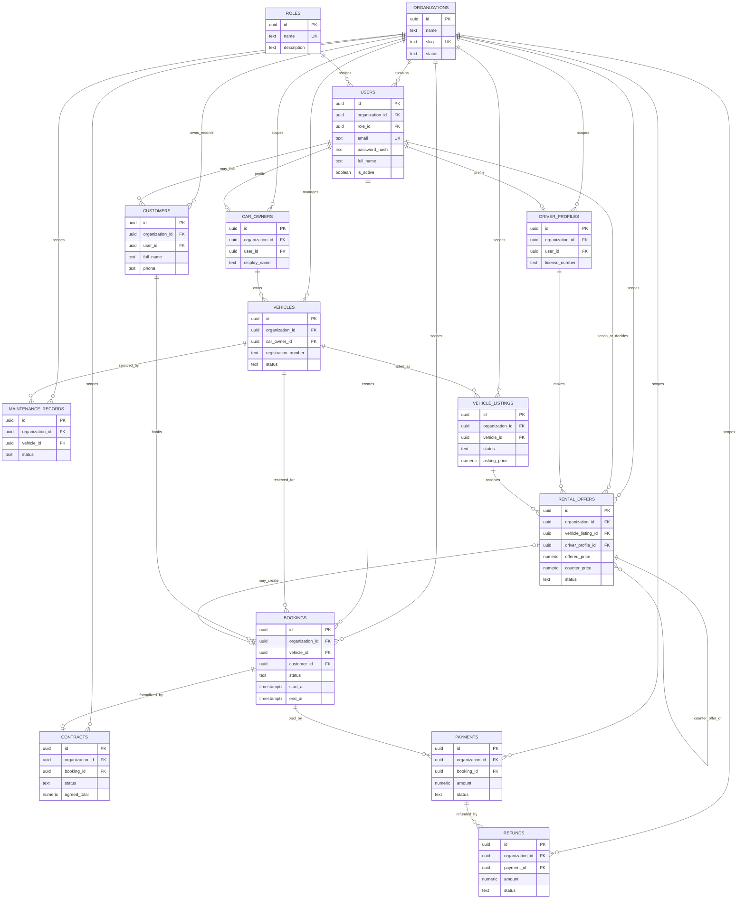

# FleetFlow Database ERD

## 1. Purpose and design assumptions

This document describes the planned PostgreSQL schema for FleetFlow, a multi-tenant car rental and fleet management system. It is designed to stay aligned with `docs/architecture.md`.

The system supports two vehicle-owner workflows:

1. **Garage/fleet operator management:** a car owner authorizes a garage or fleet operator to manage a vehicle under an agreement.
2. **Direct driver negotiation:** a cab driver views a published vehicle listing and sends an offer. The owner may accept, reject, or counter with another price. The driver may then accept, reject, or counter again.

This is a proposed schema, not a claim that the database has already been implemented or tested.

### Naming and data rules

- Table and column names use PostgreSQL `snake_case`.
- Primary keys use UUIDs.
- Money uses `numeric(12,2)`, never `float` or `double precision`.
- Dates and event timestamps use `timestamptz`; store timestamps in UTC.
- Statuses are stored as PostgreSQL enums in this design. If the team later chooses lookup tables or checked text columns, update this document and migrations together.
- Each table has `created_at`, `updated_at`, and `created_by`. `created_by` is a nullable UUID foreign key to `users.id` because some initial/system-created rows may not have a human actor. Updates to important records should also be represented in a status history or audit log when that history is required.
- For brevity, `created_at` and `updated_at` are shown as `timestamptz NOT NULL DEFAULT now()`, and `created_by` as `uuid NULL REFERENCES users(id)`. The `organizations` table is the bootstrap exception: its `created_by` foreign key is added after `users` exists, or created nullable in the initial migration and then constrained.

## 2. Entity relationship diagram

The diagram shows the main relationships. Audit columns and some supporting constraints are described in the entity definitions below.

**Relationship notes**

- An organization owns or scopes its private operational records. Marketplace discovery is a controlled exception: a listing can be visible to an eligible driver outside the listing owner’s organization, but only approved public fields are returned.
- `roles` contains global role definitions. Each user has one initial role in this simplified model. If users need multiple roles, replace `users.role_id` with a `user_roles` join table and update the ERD.
- `rental_offers.counter_offer_of` points to the earlier offer/counter-offer, forming a negotiation chain. Do not overwrite the previous offer’s price to represent a counter.
- An accepted offer may create a booking. The application must enforce that one accepted offer cannot create multiple bookings.
- A garage/fleet management agreement is part of the architecture workflow. If the implementation needs explicit agreement records, add a `management_agreements` table with owner, operator organization, vehicle, dates, fee terms, status, and audit columns before implementing that workflow. It is intentionally identified as a follow-up schema addition rather than silently implied by the entities requested here.

## 3. Common audit columns

Every table below includes these columns:

| Column | PostgreSQL type | Rules | Meaning |
|---|---|---|---|
| `created_at` | `timestamptz` | `NOT NULL DEFAULT now()` | When the row was created |
| `updated_at` | `timestamptz` | `NOT NULL DEFAULT now()` | When the row was last updated; update it in the application or a database trigger |
| `created_by` | `uuid` | Nullable FK to `users(id)` | User who created the row; null is allowed for bootstrap/system-created records |

For the `organizations` table, create it first, then create `users`, and then add the `organizations.created_by -> users.id` foreign key in a later migration to avoid a creation-order problem. For any table that uses `created_by`, the actor must be authenticated and authorized. `created_by` is not a replacement for a dedicated audit event log.

## 4. Entity definitions

In each section, the listed columns are the entity-specific columns plus the three common audit columns above. `id` is always the primary key (`uuid PRIMARY KEY DEFAULT gen_random_uuid()`), unless otherwise noted. Enable an appropriate UUID generation function in PostgreSQL, such as `pgcrypto`, if database-side UUID generation is used.

### 4.1 `organizations`

**Purpose:** Tenant boundary for a company, garage/fleet operator, or independent owner account.

| Column | Type | Constraints / meaning |
|---|---|---|
| `id` | `uuid` | Primary key |
| `name` | `varchar(160)` | `NOT NULL`; organization display name |
| `slug` | `varchar(100)` | `NOT NULL UNIQUE`; URL-friendly unique identifier |
| `status` | `organization_status` | `NOT NULL DEFAULT 'active'` |
| `contact_email` | `varchar(254)` | Nullable; validate format in application |
| `contact_phone` | `varchar(32)` | Nullable |
| `created_at` | `timestamptz` | Common audit column |
| `updated_at` | `timestamptz` | Common audit column |
| `created_by` | `uuid` | Nullable FK to `users(id)`, added after `users` is created |

**Unique constraints:** `UNIQUE (slug)`.  
**Foreign keys:** `created_by -> users.id` (deferred to a later migration due to circular creation order).  
**Multi-tenancy:** This is the tenant root; other organization-owned tables reference it.  
**Notes:** An independent owner can use a personal organization so the same tenant boundary applies consistently.

### 4.2 `roles`

**Purpose:** Global set of application roles.

| Column | Type | Constraints / meaning |
|---|---|---|
| `id` | `uuid` | Primary key |
| `name` | `varchar(60)` | `NOT NULL UNIQUE`; stable role key |
| `description` | `varchar(240)` | Nullable |
| `created_at` | `timestamptz` | Common audit column |
| `updated_at` | `timestamptz` | Common audit column |
| `created_by` | `uuid` | Nullable FK to `users(id)` |

**Unique constraints:** `UNIQUE (name)`.  
**Foreign keys:** `created_by -> users.id`.  
**Multi-tenancy:** No `organization_id`; role definitions are shared globally. Role assignments do not override organization/resource-level checks.  
**Notes:** Seed only approved roles, for example `PLATFORM_ADMIN`, `ORG_ADMIN`, `CAR_OWNER`, `FLEET_OPERATOR`, `CAB_DRIVER`, and `CUSTOMER`. Seed rows may have `created_by = NULL`.

### 4.3 `users`

**Purpose:** Login identity and organization membership.

| Column | Type | Constraints / meaning |
|---|---|---|
| `id` | `uuid` | Primary key |
| `organization_id` | `uuid` | `NOT NULL` FK to `organizations(id)` |
| `role_id` | `uuid` | `NOT NULL` FK to `roles(id)` |
| `email` | `varchar(254)` | `NOT NULL`; normalized to lowercase |
| `password_hash` | `text` | `NOT NULL`; strong one-way password hash only |
| `full_name` | `varchar(160)` | `NOT NULL` |
| `phone` | `varchar(32)` | Nullable |
| `is_active` | `boolean` | `NOT NULL DEFAULT true` |
| `last_login_at` | `timestamptz` | Nullable |
| `created_at` | `timestamptz` | Common audit column |
| `updated_at` | `timestamptz` | Common audit column |
| `created_by` | `uuid` | Nullable FK to `users(id)` |

**Unique constraints:** `UNIQUE (email)` for a globally unique login email. If the product chooses organization-specific emails instead, use `UNIQUE (organization_id, email)` and document the login lookup rules.  
**Foreign keys:** `organization_id -> organizations.id`; `role_id -> roles.id`; `created_by -> users.id`.  
**Multi-tenancy:** Has `organization_id` because each user operates within a tenant context.  
**Notes:** Never store a plaintext password, JWT, or payment credential here. A role alone does not grant access to every record.

### 4.4 `car_owners`

**Purpose:** Owner profile attached to a login identity.

| Column | Type | Constraints / meaning |
|---|---|---|
| `id` | `uuid` | Primary key |
| `organization_id` | `uuid` | `NOT NULL` FK to `organizations(id)` |
| `user_id` | `uuid` | `NOT NULL UNIQUE` FK to `users(id)` |
| `display_name` | `varchar(160)` | `NOT NULL` |
| `verification_status` | `profile_verification_status` | `NOT NULL DEFAULT 'pending'` |
| `payout_reference` | `varchar(180)` | Nullable provider token/reference only; do not store bank secrets |
| `created_at` | `timestamptz` | Common audit column |
| `updated_at` | `timestamptz` | Common audit column |
| `created_by` | `uuid` | Nullable FK to `users(id)` |

**Unique constraints:** `UNIQUE (user_id)`.  
**Foreign keys:** `organization_id -> organizations.id`; `user_id -> users.id`; `created_by -> users.id`.  
**Multi-tenancy:** Has `organization_id` to keep owner profile and payout-related references in the correct tenant.  
**Notes:** An owner can own multiple vehicles. The owner profile does not by itself grant a garage/operator management permission.

### 4.5 `driver_profiles`

**Purpose:** Cab-driver profile attached to a login identity.

| Column | Type | Constraints / meaning |
|---|---|---|
| `id` | `uuid` | Primary key |
| `organization_id` | `uuid` | `NOT NULL` FK to `organizations(id)` |
| `user_id` | `uuid` | `NOT NULL UNIQUE` FK to `users(id)` |
| `license_number` | `varchar(80)` | `NOT NULL`; sensitive personal information |
| `license_expiry_date` | `date` | `NOT NULL` |
| `verification_status` | `profile_verification_status` | `NOT NULL DEFAULT 'pending'` |
| `is_available` | `boolean` | `NOT NULL DEFAULT true` |
| `created_at` | `timestamptz` | Common audit column |
| `updated_at` | `timestamptz` | Common audit column |
| `created_by` | `uuid` | Nullable FK to `users(id)` |

**Unique constraints:** `UNIQUE (user_id)`; consider a unique normalized license number only if legally and operationally appropriate.  
**Foreign keys:** `organization_id -> organizations.id`; `user_id -> users.id`; `created_by -> users.id`.  
**Multi-tenancy:** Has `organization_id`; private driver details must not be exposed by public listing queries.  
**Notes:** Do not expose full license information to car owners unless a verified workflow requires it.

### 4.6 `vehicles`

**Purpose:** Vehicle identity and operational state.

| Column | Type | Constraints / meaning |
|---|---|---|
| `id` | `uuid` | Primary key |
| `organization_id` | `uuid` | `NOT NULL` FK to `organizations(id)`; organization responsible for management |
| `car_owner_id` | `uuid` | `NOT NULL` FK to `car_owners(id)` |
| `registration_number` | `varchar(32)` | `NOT NULL`; normalized |
| `make` | `varchar(80)` | `NOT NULL` |
| `model` | `varchar(100)` | `NOT NULL` |
| `model_year` | `smallint` | Nullable; validate reasonable range |
| `vehicle_type` | `varchar(40)` | `NOT NULL`; e.g. hatchback, sedan, SUV |
| `seat_count` | `smallint` | `NOT NULL`; `CHECK (seat_count > 0)` |
| `fuel_type` | `varchar(30)` | Nullable |
| `status` | `vehicle_status` | `NOT NULL DEFAULT 'available'` |
| `odometer_km` | `integer` | `NOT NULL DEFAULT 0`; `CHECK (odometer_km >= 0)` |
| `created_at` | `timestamptz` | Common audit column |
| `updated_at` | `timestamptz` | Common audit column |
| `created_by` | `uuid` | Nullable FK to `users(id)` |

**Unique constraints:** `UNIQUE (organization_id, registration_number)`; registration numbers should also be normalized consistently before storage.  
**Foreign keys:** `organization_id -> organizations.id`; `car_owner_id -> car_owners.id`; `created_by -> users.id`.  
**Multi-tenancy:** Has `organization_id` to scope operational vehicle records and prevent cross-tenant edits.  
**Notes:** Ownership and management are separate concepts. Ensure the car owner belongs to an allowed tenant or explicitly supported owner relationship. If the vehicle is managed by a different organization, represent that authority with a management agreement rather than silently changing ownership.

### 4.7 `vehicle_listings`

**Purpose:** Publicly discoverable listing for a vehicle; separate from operational vehicle status.

| Column | Type | Constraints / meaning |
|---|---|---|
| `id` | `uuid` | Primary key |
| `organization_id` | `uuid` | `NOT NULL` FK to `organizations(id)`; tenant that owns/manages the listing record |
| `vehicle_id` | `uuid` | `NOT NULL` FK to `vehicles(id)` |
| `status` | `listing_status` | `NOT NULL DEFAULT 'draft'` |
| `title` | `varchar(160)` | `NOT NULL` |
| `description` | `text` | Nullable; sanitize on output |
| `city` | `varchar(100)` | `NOT NULL` |
| `daily_price` | `numeric(12,2)` | `NOT NULL CHECK (daily_price >= 0)` |
| `security_deposit` | `numeric(12,2)` | `NOT NULL DEFAULT 0 CHECK (security_deposit >= 0)` |
| `currency` | `char(3)` | `NOT NULL DEFAULT 'INR'` |
| `published_at` | `timestamptz` | Nullable; set when published |
| `expires_at` | `timestamptz` | Nullable |
| `created_at` | `timestamptz` | Common audit column |
| `updated_at` | `timestamptz` | Common audit column |
| `created_by` | `uuid` | Nullable FK to `users(id)` |

**Unique constraints:** Consider a partial unique index allowing only one active listing per vehicle, e.g. unique `vehicle_id` where status is `published` or `paused`. Do not use a plain unique constraint if relisting history must be kept.  
**Foreign keys:** `organization_id -> organizations.id`; `vehicle_id -> vehicles.id`; `created_by -> users.id`.  
**Multi-tenancy:** Has `organization_id` for private listing management. Published listings may be discoverable cross-tenant, but only through a controlled public projection.  
**Notes:** Never expose internal registration/owner details, tenant identifiers, private notes, or payout information in public listing results.

### 4.8 `customers`

**Purpose:** Customer details used for rental and booking records.

| Column | Type | Constraints / meaning |
|---|---|---|
| `id` | `uuid` | Primary key |
| `organization_id` | `uuid` | `NOT NULL` FK to `organizations(id)` |
| `user_id` | `uuid` | Nullable FK to `users(id)` if customer has a FleetFlow login |
| `full_name` | `varchar(160)` | `NOT NULL` |
| `email` | `varchar(254)` | Nullable |
| `phone` | `varchar(32)` | `NOT NULL` |
| `identity_reference` | `varchar(180)` | Nullable; store a secure external reference, not unnecessary raw identity documents |
| `is_active` | `boolean` | `NOT NULL DEFAULT true` |
| `created_at` | `timestamptz` | Common audit column |
| `updated_at` | `timestamptz` | Common audit column |
| `created_by` | `uuid` | Nullable FK to `users(id)` |

**Unique constraints:** Optional `UNIQUE (organization_id, email)` only when non-null and normalized; use a partial unique index for non-null email if desired. Avoid assuming a phone number is globally unique.  
**Foreign keys:** `organization_id -> organizations.id`; `user_id -> users.id`; `created_by -> users.id`.  
**Multi-tenancy:** Has `organization_id` because customer information is private to the organization that collected it.  
**Notes:** Public marketplace searches must never return customer records.

### 4.9 `bookings`

**Purpose:** Reservation of a vehicle for a customer over a time range.

| Column | Type | Constraints / meaning |
|---|---|---|
| `id` | `uuid` | Primary key |
| `organization_id` | `uuid` | `NOT NULL` FK to `organizations(id)`; booking record owner |
| `vehicle_id` | `uuid` | `NOT NULL` FK to `vehicles(id)` |
| `customer_id` | `uuid` | `NOT NULL` FK to `customers(id)` |
| `vehicle_listing_id` | `uuid` | Nullable FK to `vehicle_listings(id)` if sourced from a listing |
| `rental_offer_id` | `uuid` | Nullable FK to `rental_offers(id)` if sourced from an accepted offer |
| `created_by_user_id` | `uuid` | `NOT NULL` FK to `users(id)` |
| `start_at` | `timestamptz` | `NOT NULL` |
| `end_at` | `timestamptz` | `NOT NULL`; must be after `start_at` |
| `pickup_location` | `varchar(240)` | `NOT NULL` |
| `return_location` | `varchar(240)` | `NOT NULL` |
| `status` | `booking_status` | `NOT NULL DEFAULT 'pending'` |
| `currency` | `char(3)` | `NOT NULL DEFAULT 'INR'` |
| `quoted_total` | `numeric(12,2)` | `NOT NULL CHECK (quoted_total >= 0)` |
| `notes` | `text` | Nullable; avoid storing unnecessary sensitive data |
| `created_at` | `timestamptz` | Common audit column |
| `updated_at` | `timestamptz` | Common audit column |
| `created_by` | `uuid` | Nullable FK to `users(id)`; audit actor, separate from business `created_by_user_id` |

**Unique constraints:** No simple unique key prevents time overlaps. Use a transaction and availability lock; PostgreSQL exclusion constraints with a range type can be considered for confirmed states. Ensure `rental_offer_id` is unique when non-null so one accepted offer cannot create multiple bookings.  
**Foreign keys:** Organization, vehicle, customer, optional listing/offer, creator user, and audit creator references.  
**Multi-tenancy:** Has `organization_id` because booking details are private operational records. For marketplace bookings, define a canonical responsible tenant and validate all cross-tenant relationships explicitly.  
**Notes:** Enforce `CHECK (end_at > start_at)`. Re-check availability at confirmation time, not only when the frontend first displays it.

### 4.10 `contracts`

**Purpose:** Rental agreement that records the terms accepted for a booking.

| Column | Type | Constraints / meaning |
|---|---|---|
| `id` | `uuid` | Primary key |
| `organization_id` | `uuid` | `NOT NULL` FK to `organizations(id)` |
| `booking_id` | `uuid` | `NOT NULL UNIQUE` FK to `bookings(id)` |
| `contract_number` | `varchar(60)` | `NOT NULL`; human-readable reference |
| `status` | `contract_status` | `NOT NULL DEFAULT 'draft'` |
| `start_at` | `timestamptz` | `NOT NULL` |
| `end_at` | `timestamptz` | `NOT NULL` |
| `currency` | `char(3)` | `NOT NULL DEFAULT 'INR'` |
| `agreed_total` | `numeric(12,2)` | `NOT NULL CHECK (agreed_total >= 0)` |
| `terms_text` | `text` | Nullable; versioned template or generated terms |
| `signed_at` | `timestamptz` | Nullable |
| `completed_at` | `timestamptz` | Nullable |
| `created_at` | `timestamptz` | Common audit column |
| `updated_at` | `timestamptz` | Common audit column |
| `created_by` | `uuid` | Nullable FK to `users(id)` |

**Unique constraints:** `UNIQUE (booking_id)`; `UNIQUE (contract_number)` or `UNIQUE (organization_id, contract_number)` depending on numbering policy.  
**Foreign keys:** `organization_id -> organizations.id`; `booking_id -> bookings.id`; `created_by -> users.id`.  
**Multi-tenancy:** Has `organization_id` because contract terms and signatures are private to the responsible organization and parties.  
**Notes:** A contract should not be activated unless its booking and agreed terms pass service-layer checks. Consider immutable contract versions if terms can be amended.

### 4.11 `payments`

**Purpose:** Records a payment attempt or confirmed payment for a booking.

| Column | Type | Constraints / meaning |
|---|---|---|
| `id` | `uuid` | Primary key |
| `organization_id` | `uuid` | `NOT NULL` FK to `organizations(id)` |
| `booking_id` | `uuid` | `NOT NULL` FK to `bookings(id)` |
| `provider` | `varchar(60)` | Nullable payment provider name |
| `provider_payment_reference` | `varchar(180)` | Nullable provider reference; never card data |
| `idempotency_key` | `varchar(180)` | `NOT NULL`; unique per organization |
| `amount` | `numeric(12,2)` | `NOT NULL CHECK (amount > 0)` |
| `currency` | `char(3)` | `NOT NULL DEFAULT 'INR'` |
| `status` | `payment_status` | `NOT NULL DEFAULT 'pending'` |
| `paid_at` | `timestamptz` | Nullable; set only after verified success |
| `failure_reason` | `varchar(240)` | Nullable; avoid storing sensitive provider payloads |
| `created_at` | `timestamptz` | Common audit column |
| `updated_at` | `timestamptz` | Common audit column |
| `created_by` | `uuid` | Nullable FK to `users(id)` |

**Unique constraints:** `UNIQUE (organization_id, idempotency_key)`; optional unique `(provider, provider_payment_reference)` when the provider reference is non-null.  
**Foreign keys:** `organization_id -> organizations.id`; `booking_id -> bookings.id`; `created_by -> users(id)`.  
**Multi-tenancy:** Has `organization_id` so payment records and references are visible only to authorized tenant users.  
**Notes:** Verify provider callbacks server-side and process them idempotently. Never mark success solely from a browser response. Never store raw card numbers, CVV, or banking credentials.

### 4.12 `refunds`

**Purpose:** Refund request and provider result associated with a payment.

| Column | Type | Constraints / meaning |
|---|---|---|
| `id` | `uuid` | Primary key |
| `organization_id` | `uuid` | `NOT NULL` FK to `organizations(id)` |
| `payment_id` | `uuid` | `NOT NULL` FK to `payments(id)` |
| `provider_refund_reference` | `varchar(180)` | Nullable provider reference |
| `amount` | `numeric(12,2)` | `NOT NULL CHECK (amount > 0)` |
| `currency` | `char(3)` | `NOT NULL DEFAULT 'INR'` |
| `status` | `refund_status` | `NOT NULL DEFAULT 'requested'` |
| `reason` | `varchar(240)` | Nullable |
| `requested_at` | `timestamptz` | `NOT NULL DEFAULT now()` |
| `processed_at` | `timestamptz` | Nullable |
| `created_at` | `timestamptz` | Common audit column |
| `updated_at` | `timestamptz` | Common audit column |
| `created_by` | `uuid` | Nullable FK to `users(id)` |

**Unique constraints:** Optional unique `(provider_refund_reference)` where non-null.  
**Foreign keys:** `organization_id -> organizations.id`; `payment_id -> payments(id)`; `created_by -> users(id)`.  
**Multi-tenancy:** Has `organization_id` to scope refund details to the tenant responsible for the payment.  
**Notes:** The service must verify that cumulative successful refunds do not exceed the captured payment amount. Keep refunds separate from payments to preserve financial history.

### 4.13 `maintenance_records`

**Purpose:** Service, inspection, or repair history for a vehicle.

| Column | Type | Constraints / meaning |
|---|---|---|
| `id` | `uuid` | Primary key |
| `organization_id` | `uuid` | `NOT NULL` FK to `organizations(id)` |
| `vehicle_id` | `uuid` | `NOT NULL` FK to `vehicles(id)` |
| `maintenance_type` | `varchar(60)` | `NOT NULL`; service, repair, inspection, etc. |
| `status` | `maintenance_status` | `NOT NULL DEFAULT 'scheduled'` |
| `description` | `text` | `NOT NULL` |
| `scheduled_at` | `timestamptz` | Nullable |
| `started_at` | `timestamptz` | Nullable |
| `completed_at` | `timestamptz` | Nullable |
| `cost` | `numeric(12,2)` | `NOT NULL DEFAULT 0 CHECK (cost >= 0)` |
| `currency` | `char(3)` | `NOT NULL DEFAULT 'INR'` |
| `service_provider` | `varchar(160)` | Nullable |
| `created_at` | `timestamptz` | Common audit column |
| `updated_at` | `timestamptz` | Common audit column |
| `created_by` | `uuid` | Nullable FK to `users(id)` |

**Unique constraints:** None required by default.  
**Foreign keys:** `organization_id -> organizations(id)`; `vehicle_id -> vehicles(id)`; `created_by -> users(id)`.  
**Multi-tenancy:** Has `organization_id` because maintenance notes, costs, and scheduling are private operational data.  
**Notes:** A vehicle that is unsafe or under blocking maintenance must not be confirmed for an overlapping booking. Define explicitly which maintenance statuses block availability.

### 4.14 `rental_offers`

**Purpose:** Offer/counter-offer history between a driver and a vehicle listing.

| Column | Type | Constraints / meaning |
|---|---|---|
| `id` | `uuid` | Primary key |
| `organization_id` | `uuid` | `NOT NULL` FK to `organizations(id)`; tenant responsible for this offer record |
| `vehicle_listing_id` | `uuid` | `NOT NULL` FK to `vehicle_listings(id)` |
| `driver_profile_id` | `uuid` | `NOT NULL` FK to `driver_profiles(id)` |
| `parent_offer_id` | `uuid` | Nullable self-FK to `rental_offers(id)`; previous offer being countered |
| `created_by_user_id` | `uuid` | `NOT NULL` FK to `users(id)`; actor who sent this offer |
| `offered_price` | `numeric(12,2)` | `NOT NULL CHECK (offered_price > 0)` |
| `counter_price` | `numeric(12,2)` | Nullable `CHECK (counter_price > 0)`; set when this record represents a counter |
| `currency` | `char(3)` | `NOT NULL DEFAULT 'INR'` |
| `status` | `offer_status` | `NOT NULL DEFAULT 'pending'` |
| `message` | `varchar(500)` | Nullable; validate and sanitize |
| `expires_at` | `timestamptz` | Nullable |
| `responded_at` | `timestamptz` | Nullable; when this offer was answered |
| `accepted_at` | `timestamptz` | Nullable; set only on acceptance |
| `rejected_at` | `timestamptz` | Nullable |
| `created_at` | `timestamptz` | Common audit column |
| `updated_at` | `timestamptz` | Common audit column |
| `created_by` | `uuid` | Nullable FK to `users(id)`; common audit actor |

**Unique constraints:** No simple unique constraint is needed for a negotiation chain. Add an application/transaction rule so one listing cannot have two accepted offers for the same rental period.  
**Foreign keys:** `organization_id -> organizations.id`; `vehicle_listing_id -> vehicle_listings.id`; `driver_profile_id -> driver_profiles.id`; `parent_offer_id -> rental_offers.id`; `created_by_user_id -> users.id`; `created_by -> users.id`.  
**Multi-tenancy:** Has `organization_id` for the private record and audit scope. Drivers may only create offers against eligible published listings; a carefully scoped marketplace service may cross tenant boundaries.  
**Notes:** Keep each counter-offer as a new row linked by `parent_offer_id`. `offered_price` is the price proposed in this row; `counter_price` is the counter amount when a party counters. Define the API rule clearly so both fields are not ambiguously used for the same event. Acceptance must be transactional and should result in one booking at the accepted agreed price. Store the accepted price on the booking/contract as a snapshot so later listing price changes do not change the agreement.

## 5. Status enums

These are the suggested PostgreSQL enum values. Keep transitions in service logic and reject invalid transitions.

| Enum type | Values | Notes |
|---|---|---|
| `organization_status` | `active`, `suspended`, `closed` | Suspended/closed tenants cannot perform normal business operations |
| `profile_verification_status` | `pending`, `verified`, `rejected`, `expired` | Used by owner and driver profiles |
| `vehicle_status` | `available`, `reserved`, `rented`, `maintenance`, `inactive` | Operational status; independent of listing publication |
| `listing_status` | `draft`, `published`, `paused`, `rented`, `archived` | Controls marketplace visibility |
| `booking_status` | `pending`, `confirmed`, `in_progress`, `completed`, `cancelled`, `rejected`, `expired` | Only valid confirmed/in-progress bookings block availability according to policy |
| `contract_status` | `draft`, `pending_signature`, `active`, `completed`, `cancelled`, `terminated` | Active contract must be tied to valid agreed terms |
| `payment_status` | `pending`, `authorized`, `succeeded`, `failed`, `cancelled`, `partially_refunded`, `refunded` | Derive refund-related states from verified financial records |
| `refund_status` | `requested`, `pending`, `succeeded`, `failed`, `cancelled` | Successful refund totals must not exceed captured payment |
| `maintenance_status` | `scheduled`, `in_progress`, `completed`, `cancelled` | Define which statuses block vehicle availability |
| `offer_status` | `pending`, `countered`, `accepted`, `rejected`, `withdrawn`, `expired` | A terminal offer cannot be accepted or edited later |

PostgreSQL enum values are harder to remove than ordinary text values. Add new values through reviewed migrations. If workflows change often, use text columns with `CHECK` constraints or lookup tables instead.

## 6. Multi-tenancy: `organization_id` policy

| Table | `organization_id`? | Why |
|---|---|---|
| `organizations` | No | This is the tenant root |
| `roles` | No | Shared global role definitions |
| `users` | Yes | Establishes the user's default tenant context |
| `car_owners` | Yes | Scopes owner profile and private details |
| `driver_profiles` | Yes | Scopes private driver details |
| `vehicles` | Yes | Scopes operational vehicle management |
| `vehicle_listings` | Yes | Scopes editing and administration; published listing fields may be discoverable through a controlled cross-tenant query |
| `customers` | Yes | Customer personal data belongs to the collecting tenant |
| `bookings` | Yes | Booking and customer relationship is private to the responsible tenant |
| `contracts` | Yes | Contract terms and signatures are private to authorized parties |
| `payments` | Yes | Payment data and provider references are tenant-scoped |
| `refunds` | Yes | Refund operations are scoped to the responsible tenant |
| `maintenance_records` | Yes | Service records and costs are private operational data |
| `rental_offers` | Yes | Offer history is scoped; marketplace interaction must use an explicit permission path |

### Required tenant-safety rules

1. Resolve tenant context from the authenticated user and trusted server-side membership, not from a client-provided ID alone.
2. Scope normal queries and writes by `organization_id`.
3. Validate that each related record is in the permitted tenant or has an explicit supported cross-tenant relationship.
4. For published listings, return a public DTO containing only approved fields; do not bypass all tenant checks just because a listing is public.
5. Check tenant access before reading or changing status, price, payment, refund, maintenance, and offer records.
6. Consider composite foreign keys such as `(organization_id, vehicle_id)` where appropriate, backed by matching unique constraints, to prevent accidental cross-tenant references at the database layer.
7. Consider PostgreSQL row-level security as defense in depth, but keep application-level authorization too.
8. Test unauthorized cross-tenant reads/writes and marketplace edge cases before production. This document does not claim those tests have been run.

## 7. Suggested indexes

PostgreSQL creates indexes for primary keys and unique constraints automatically. The following additional indexes are recommended; confirm them against real query patterns and use `EXPLAIN ANALYZE` with representative data before production.

| Table | Suggested index | Purpose |
|---|---|---|
| `users` | `UNIQUE (email)` | Login lookup |
| `users` | `(organization_id, is_active)` | List active tenant users |
| `vehicles` | `(organization_id, status)` | Tenant fleet/status filter |
| `vehicles` | `UNIQUE (organization_id, registration_number)` | Avoid duplicate registration within a tenant |
| `vehicles` | `(car_owner_id)` | Find an owner's vehicles |
| `vehicle_listings` | `(status, city, daily_price)` | Public search by listing status, city, price |
| `vehicle_listings` | `(organization_id, status, created_at DESC)` | Tenant listing administration |
| `vehicle_listings` | Partial index on `vehicle_id` for active listings | Find active listing; consider partial unique index if policy allows one |
| `customers` | `(organization_id, phone)` | Tenant customer lookup |
| `customers` | `(organization_id, lower(email))` where email is not null | Email lookup; can be unique if product policy requires it |
| `bookings` | `(organization_id, status, start_at)` | Tenant booking dashboard |
| `bookings` | `(vehicle_id, start_at, end_at)` | Availability checks |
| `bookings` | `(customer_id, created_at DESC)` | Customer booking history |
| `bookings` | `UNIQUE (rental_offer_id)` where non-null | Prevent one offer creating multiple bookings |
| `contracts` | `UNIQUE (contract_number)` or `(organization_id, contract_number)` | Contract lookup |
| `payments` | `UNIQUE (organization_id, idempotency_key)` | Safe retry/idempotency |
| `payments` | `(booking_id, status)` | Payment status per booking |
| `payments` | Unique provider reference where non-null | Provider callback lookup |
| `refunds` | `(payment_id, status)` | Refund total/status calculation |
| `maintenance_records` | `(organization_id, status, scheduled_at)` | Upcoming and open maintenance |
| `maintenance_records` | `(vehicle_id, status, scheduled_at)` | Vehicle maintenance/availability |
| `car_owners` | `UNIQUE (user_id)` | Profile lookup |
| `driver_profiles` | `UNIQUE (user_id)` | Profile lookup |
| `rental_offers` | `(vehicle_listing_id, status, created_at DESC)` | Listing offer inbox |
| `rental_offers` | `(driver_profile_id, created_at DESC)` | Driver's offer history |
| `rental_offers` | `(parent_offer_id)` | Follow negotiation chain |
| All tenant-owned tables | `(organization_id)` where not already leading an appropriate composite index | Tenant-scoped filters and joins |

For booking overlap prevention, consider a PostgreSQL exclusion constraint using a `tstzrange(start_at, end_at, '[)')` and a GiST index for blocking statuses, if the chosen schema and concurrency requirements support it. A normal B-tree index alone does not prevent overlapping bookings. Partial-index predicates must match the chosen status policy.

## 8. Sample rows

These are illustrative examples only, not real records from the repository or test data. UUIDs and names are made up.

### `organizations`

| id | name | slug | status |
|---|---|---|---|
| `11111111-1111-4111-8111-111111111111` | Kolkata City Rentals | `kolkata-city-rentals` | `active` |
| `22222222-2222-4222-8222-222222222222` | Independent Owner Workspace | `independent-owner` | `active` |

### `vehicle_listings`

| id | vehicle_id | city | daily_price | security_deposit | currency | status |
|---|---|---|---:|---:|---|---|
| `33333333-3333-4333-8333-333333333333` | `44444444-4444-4444-8444-444444444444` | Kolkata | ₹2,000.00 | ₹5,000.00 | INR | `published` |
| `55555555-5555-4555-8555-555555555555` | `66666666-6666-4666-8666-666666666666` | Howrah | ₹1,650.00 | ₹4,000.00 | INR | `published` |

### `rental_offers`

| id | vehicle_listing_id | offered_price | counter_price | currency | status | created_at | accepted_at |
|---|---|---:|---:|---|---|---|---|
| `77777777-7777-4777-8777-777777777777` | `33333333-3333-4333-8333-333333333333` | ₹1,700.00 | ₹1,850.00 | INR | `countered` | `2026-11-27 09:00:00+00` | — |
| `88888888-8888-4888-8888-888888888888` | `33333333-3333-4333-8333-333333333333` | ₹1,850.00 | — | INR | `accepted` | `2026-11-27 10:00:00+00` | `2026-11-27 10:05:00+00` |

In this example, the second row represents a later offer in the negotiation chain; in the real schema it should point to the earlier row through `parent_offer_id`. The accepted agreed price should be copied into the resulting booking and contract as a snapshot.

### `payments` and `refunds`

| Table | Amount | Currency | Status | Meaning |
|---|---:|---|---|---|
| `payments` | ₹7,000.00 | INR | `succeeded` | Payment confirmed by the provider |
| `refunds` | ₹1,000.00 | INR | `succeeded` | Partial refund against that payment |

All sample rows are illustrative. They do not imply that these rows exist in the database or that any tests have passed.

## 9. Migration and implementation order

Suggested migration sequence:

1. Enable UUID generation support if needed; create `organizations` without its `created_by` FK.
2. Create enum types and `roles`.
3. Create `users`, then add `organizations.created_by -> users.id`.
4. Create `car_owners` and `driver_profiles`.
5. Create `vehicles`, then `vehicle_listings` and `customers`.
6. Create `bookings`, `contracts`, `payments`, and `refunds`.
7. Create `maintenance_records` and `rental_offers`.
8. Add remaining foreign keys, check constraints, indexes, and optional composite tenant constraints.
9. Seed the global roles with `created_by = NULL` if appropriate.
10. Add tests for tenant isolation, relationship integrity, booking overlap, offer transitions, payment idempotency, and refund limits.

Keep this document and database migration files in sync. Any change to table names, status values, relationship cardinality, or tenant policy should be reflected in both `docs/database-erd.md` and `docs/architecture.md`.
