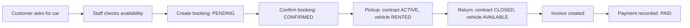
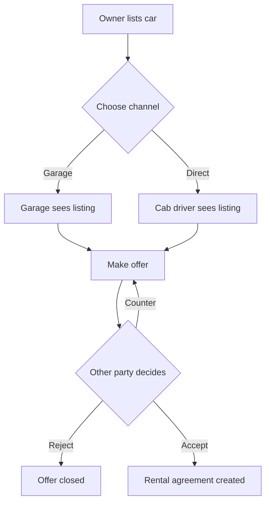
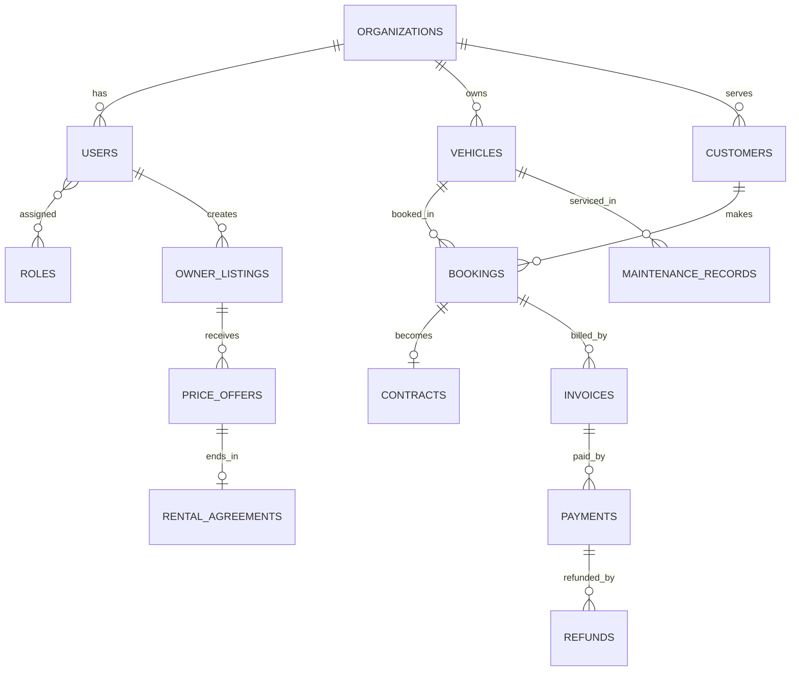

# Phase 1: Architecture and Planning

> **Project:** FleetFlow Car Rental & Fleet Management System
> **Phase type:** Design only (no application code)
> **Where this file lives:** `docs/phases/phase-01-architecture-and-planning.md`
> **Status:** Complete the checklist at the bottom before starting Phase 2.

---

## 1. What is this phase?

Phase 1 is the **plan before the code**. You decide what the system does, who uses it, what data it stores, and how the parts talk to each other. You write these decisions in four documents inside the `docs/` folder.

**Why it matters**

- Changing a plan on paper takes minutes. Changing a database or API after 5 phases of code takes days.
- Every later phase copies from these four documents. Phase 3 builds tables from the ERD. Phase 4 builds security from the permissions matrix. Phases 5 to 10 build endpoints from the API design.
- In interviews, these documents show you think like a professional developer.

**What you will produce**

| File | Answers the question |
|---|---|
| `docs/architecture.md` | How is the system organized? |
| `docs/database-erd.md` | What data do we store and how is it connected? |
| `docs/permissions-matrix.md` | Who is allowed to do what? |
| `docs/api-design.md` | Which URLs does the backend offer? |

You also set up the **git plan** (branches and commit style) and the **folder structure**.

---

## 2. Your current repo structure

```
fleetflow-car-rental-system/
  backend/
  docker/
  docs/
  frontend/
  .env.example
  .gitignore
  README.md
  docker-compose.yml
```

Create this extra folder for the phase guides (this file is the first one):

```
docs/
  phases/
    README.md
    phase-01-architecture-and-planning.md
    phase-02-project-setup.md          (added later)
    phase-03-database-migrations.md    (added later)
    ... one file per phase
```

Windows command:

```
cd fleetflow-car-rental-system
mkdir docs\phases
```

---

## 3. Before you start: tools and time

- A text editor (VS Code is fine) with a Markdown preview (`Ctrl+Shift+V`).
- Git installed (`git --version`).
- Optional: a free diagram tool. You can write diagrams as text with **Mermaid** (GitHub shows them automatically), so you do not need extra software.
- Time: plan 1 to 2 days of calm work. Do not rush this phase.

---

## 4. Step-by-step work

Follow the steps in order. Each step says **what to do**, **how to do it**, and **what the result looks like**.

### Step 1: Write the project goal in your own words

**What:** Two or three sentences that say what FleetFlow is and who it is for.

**How:** Open `docs/architecture.md` and write a section called `## 1. Overview`.

**Example:**

> FleetFlow is a multi-tenant web application for car rental businesses (garages and fleet operators). Each business manages its own vehicles, customers, bookings, contracts, billing, and maintenance. Individual car owners can also list their cars. A car owner can give a car to a garage, or negotiate a price directly with a cab driver.

**Result:** Anyone reading the first paragraph understands the project.

---

### Step 2: List the users (actors) and what they want

**What:** Write every type of person who uses the system.

**How:** Make a table in `architecture.md`, section `## 2. Users and roles`.

| Role | Who they are | Main goal |
|---|---|---|
| SUPER_ADMIN | Platform owner (you) | Manage organizations, see platform health |
| ORGANIZATION_ADMIN | Owner or manager of one rental business | Control everything inside the business |
| FLEET_MANAGER | Person who manages cars | Add vehicles, manage maintenance |
| STAFF | Counter or booking staff | Handle customers, bookings, pickup and return |
| VIEWER | Accountant or auditor | Read reports only |
| CAR_OWNER | Individual who owns a car | List the car and earn from it (Phase 8) |
| CAB_DRIVER | Driver who wants to rent a car | Find a car and negotiate the price (Phase 8) |

**Tip:** Add CAR_OWNER and CAB_DRIVER now, even though you build them in Phase 8. Then you never redesign security later.

---

### Step 3: List the modules and their features

**What:** Break the system into modules. A module is one area of the business.

**How:** In `architecture.md`, section `## 3. Modules`, write each module with 3 to 6 bullet points.

| Module | Main features |
|---|---|
| Auth and users | Login, logout, token refresh, user management, role assignment |
| Organizations | Create business, tenant isolation, business settings |
| Vehicles | Add, edit, search, status, documents (insurance, PUC) |
| Customers | Add, edit, licence details, rental history |
| Bookings | Check availability, create, confirm, cancel, price calculation |
| Contracts | Pickup form, return form, damage notes, odometer and fuel |
| Billing | Invoices, payments, refunds, late fees, PDF invoice |
| Maintenance | Service records, reminders, block vehicle while in repair |
| Marketplace | Owner listings, offers, counter offers, rental agreements |
| Dashboard and reports | Revenue, utilization, overdue returns, CSV and PDF export |

---

### Step 4: Draw the main workflows

**What:** Show how a real day works, step by step. Workflows find missing features before you code.

**How:** In `architecture.md`, section `## 4. Workflows`, write each workflow as a numbered list or a Mermaid diagram.

**Workflow A: Normal rental**



**Workflow B: Maintenance**

1. Fleet manager schedules a service for a vehicle.
2. When work starts, vehicle status becomes MAINTENANCE.
3. While in MAINTENANCE, the car cannot be booked.
4. When work is completed, cost is saved and status returns to AVAILABLE.

**Workflow C: Owner and driver negotiation (new requirement)**



Write the rules under the diagram: only the other party can accept, every offer is saved, offers expire after 48 hours.

---

### Step 5: Choose your architecture and layers

**What:** Decide how backend code is organized so every module looks the same.

**How:** In `architecture.md`, section `## 5. Technical architecture`.

**Layers (backend):**

```
Controller  ->  Service  ->  Repository  ->  Database
 (HTTP)        (rules)       (queries)
```

- **Controller:** receives the request, checks input, returns the response. No business rules here.
- **Service:** all business rules (for example: no double booking). Marked `@Transactional` when it changes several tables.
- **Repository:** talks to the database. Every query on business data filters by `organization_id`.
- **DTO:** request and response objects. Never send the database entity directly to the client.

**Backend package layout (decide now, use forever):**

```
com.fleetflow
  auth/        security/     tenant/       common/
  organization/ user/        vehicle/      customer/
  booking/     contract/     billing/      maintenance/
  marketplace/ dashboard/    report/
```

Each module folder holds: `Entity`, `Repository`, `Service`, `Controller`, `dto/`.

**Frontend layout:**

```
src/
  api/  pages/  components/  context/  routes/  types/  utils/  hooks/
```

**Technology table to copy:**

| Part | Choice |
|---|---|
| Language | Java 21 |
| Backend framework | Spring Boot 3.x |
| Security | Spring Security + JWT |
| Database access | Spring Data JPA |
| Database | PostgreSQL 16 |
| Migrations | Flyway |
| API docs | Swagger / OpenAPI |
| Build | Maven |
| Frontend | React + TypeScript + Vite + Tailwind CSS |
| Testing | JUnit 5, Mockito, Testcontainers |
| Packaging | Docker and Docker Compose |

---

### Step 6: Decide the multi-tenant rule

**What:** One system, many rental businesses. Their data must never mix.

**How:** In `architecture.md`, section `## 6. Multi-tenancy`, write these rules:

1. Every business table has a column `organization_id`.
2. The logged-in user's `organization_id` is stored inside the JWT token.
3. The backend reads the organization from the token, never from the request body or URL.
4. Every repository query filters by `organization_id`.
5. If a record belongs to another organization, return **404 Not Found** (not 403), so its existence is not revealed.
6. Unique values (for example, plate number) are unique **per organization**, not globally.

---

### Step 7: Design the database (ERD)

**What:** The Entity Relationship Diagram. It lists tables, columns, and links between tables.

**How:** Open `docs/database-erd.md`. Write three parts: the diagram, a table per entity, and the naming rules.

**Naming rules to write at the top**

- Table names: plural, snake_case (`vehicles`, `price_offers`)
- Column names: snake_case (`plate_number`)
- Primary key: `id` (BIGSERIAL)
- Every table has `created_at` and `updated_at`
- Money columns: `NUMERIC(12,2)` (never float)
- Status columns: text values checked by a constraint (`AVAILABLE`, `RENTED`...)

**The diagram (Mermaid):**



**Entity detail (write one table like this for every entity):**

`vehicles`

| Column | Type | Rule |
|---|---|---|
| id | BIGSERIAL | Primary key |
| organization_id | BIGINT | Foreign key, required |
| plate_number | VARCHAR(20) | Required, unique per organization |
| make, model | VARCHAR(50) | Required |
| year | INT | Required |
| daily_rate | NUMERIC(12,2) | Required, greater than 0 (in ₹) |
| status | VARCHAR(20) | AVAILABLE, RENTED, MAINTENANCE |
| created_at, updated_at | TIMESTAMP | Automatic |

Do the same for: `organizations`, `users`, `roles`, `user_roles`, `customers`, `bookings`, `contracts`, `invoices`, `invoice_lines`, `payments`, `refunds`, `maintenance_records`, `owner_listings`, `price_offers`, `rental_agreements`.

**Decide and write down these business rules now:**

- Can a vehicle be deleted if it has bookings? (Recommended: no, use soft delete with an `active` flag.)
- Is a booking day range `[start, end)`, meaning the return day is free for the next customer? (Write the exact rule.)
- Are payments editable? (Recommended: never edit; add a reversing entry.)
- Which amounts include GST? Where is the tax rate stored? (Recommended: config value, 18% as an example.)

---

### Step 8: Write the permissions matrix

**What:** A table of who can do which action. Phase 4 turns it into code.

**How:** Open `docs/permissions-matrix.md`. Use R = read, C = create, U = update, D = delete, `-` = no access.

| Module | SUPER_ADMIN | ORG_ADMIN | FLEET_MANAGER | STAFF | VIEWER | CAR_OWNER | CAB_DRIVER |
|---|---|---|---|---|---|---|---|
| Organizations | CRUD | R, U (own) | - | - | - | - | - |
| Users | CRUD | CRUD (own org) | - | - | - | R, U (self) | R, U (self) |
| Vehicles | R | CRUD | CRUD | R | R | - | - |
| Customers | R | CRUD | R | CRU | R | - | - |
| Bookings | R | CRUD | R | CRU | R | - | - |
| Contracts | R | CRUD | R | CRU | R | - | - |
| Invoices and payments | R | CRUD | - | CR | R | - | - |
| Refunds | R | CRU | - | - | R | - | - |
| Maintenance | R | CRUD | CRUD | R | R | - | - |
| Dashboard (numbers) | R | R | R (fleet only) | R (limited) | R | - | - |
| Reports and export | R | R | R (fleet only) | - | R | - | - |
| Owner listings | R | R | R | - | - | CRUD (own) | R |
| Price offers | - | CRU (as garage) | - | - | - | CRU (own listing) | CRU (own offers) |

This is a starting point. Change it to match your own rules, then keep it as the one source of truth. Add a short note under the table: "Own organization only" applies to every ORG_ADMIN, FLEET_MANAGER, STAFF and VIEWER row.

---

### Step 9: Design the API

**What:** The list of URLs the backend will offer. The frontend team (you, in Phase 5 onward) reads this list.

**How:** Open `docs/api-design.md`. Write the rules first, then the endpoint tables.

**Rules to write at the top**

- All URLs start with `/api`.
- Use plural nouns: `/api/vehicles`, not `/api/getVehicle`.
- Verbs: `GET` read, `POST` create, `PUT` full update, `PATCH` small change, `DELETE` remove.
- Lists support `page`, `size`, `sort`, and filters.
- Every response uses the same shape:

```json
{
  "success": true,
  "message": "Vehicle created",
  "data": { "id": 12, "plateNumber": "WB02AB1234" }
}
```

- Error codes: `400` invalid input, `401` not logged in, `403` not allowed, `404` not found, `409` business rule broken (for example, double booking).

**Endpoint tables (one table per module, example for vehicles):**

| Method | URL | Purpose | Roles |
|---|---|---|---|
| GET | `/api/vehicles` | List with filters | All logged-in roles |
| GET | `/api/vehicles/{id}` | One vehicle | All logged-in roles |
| POST | `/api/vehicles` | Create | ORG_ADMIN, FLEET_MANAGER |
| PUT | `/api/vehicles/{id}` | Update | ORG_ADMIN, FLEET_MANAGER |
| DELETE | `/api/vehicles/{id}` | Remove (soft) | ORG_ADMIN |
| GET | `/api/vehicles/available?from=&to=` | Free cars for dates | STAFF and above |

Write the same kind of table for: auth, users, customers, bookings, contracts, invoices, payments, maintenance, listings, offers, agreements, dashboard, reports.

---

### Step 10: Plan the screens (frontend design)

**What:** List every page the user will see. This stops you from forgetting screens in Phase 11.

**How:** In `architecture.md`, section `## 7. Frontend screens`.

| Area | Pages |
|---|---|
| Auth | Login, Forgot password (optional) |
| Dashboard | Main dashboard |
| Vehicles | List, Add/Edit, Detail with maintenance history |
| Customers | List, Add/Edit, Detail with rental history |
| Bookings | List, New booking (4 steps), Detail |
| Contracts | Start rental, Close rental, Detail |
| Billing | Invoice list, Invoice detail, Record payment |
| Maintenance | List, Schedule/Record |
| Marketplace | List my car, My listings, Browse cars, Negotiation, Agreement |
| Reports | Reports page with download buttons |
| Other | Profile, 404 page, Not allowed page |

Optional but helpful: sketch the main screens on paper or in a free tool (Figma, Excalidraw) and save the image in `docs/images/`.

---

### Step 11: Plan git (branches and commits)

**What:** A clear history helps you and impresses reviewers.

**How:** Add a section `## 8. Git plan` in `architecture.md`.

**Branches**

- `main`: always working code
- One branch per phase or feature: `phase-2-setup`, `phase-5-vehicles-customers`, `fix/booking-overlap`

**Commit message style:** `type(scope): short message`

| Type | Use for |
|---|---|
| `feat` | New feature |
| `fix` | Bug fix |
| `docs` | Documentation only |
| `chore` | Setup, config, tools |
| `test` | Tests |
| `refactor` | Code cleanup with no behavior change |

Examples: `docs(architecture): add workflows and layers`, `feat(vehicle): add search endpoint`.

**Commands to use for each phase:**

```
git checkout main
git pull
git checkout -b phase-2-setup
git add .
git commit -m "chore: project setup"
git push -u origin phase-2-setup
```

Then open a pull request on GitHub, review it yourself, and merge to `main`.

**`.gitignore` check:** make sure it ignores `.env`, `target/`, `node_modules/`, `.idea/`, `*.log`, and `dist/`. Real secrets never go into Git. `.env.example` has names only.

---

### Step 12: Write the README start and the phase index

**What:** The project front page and a map of the guide files.

**How:**

1. In the root `README.md`, write: project name, short description, planned features, tech stack, and a line "Status: Phase 1 complete". You will extend it in Phase 12.
2. Create `docs/phases/README.md` as an index:

```
# Phase Guides

| Phase | Title | File | Status |
|---|---|---|---|
| 1 | Architecture and planning | phase-01-architecture-and-planning.md | Done |
| 2 | Project setup | phase-02-project-setup.md | Not started |
| 3 | Database and migrations | phase-03-database-migrations.md | Not started |
| 4 | Auth, security, multi-tenancy | phase-04-auth-security-tenancy.md | Not started |
| 5 | Vehicles and customers | phase-05-vehicles-customers.md | Not started |
| 6 | Booking and availability | phase-06-booking-availability.md | Not started |
| 7 | Contracts and billing | phase-07-contracts-billing.md | Not started |
| 8 | Owner marketplace | phase-08-owner-marketplace.md | Not started |
| 9 | Maintenance | phase-09-maintenance.md | Not started |
| 10 | Dashboard and reports | phase-10-dashboard-reports.md | Not started |
| 11 | Frontend completion | phase-11-frontend-completion.md | Not started |
| 12 | Testing, deployment, polish | phase-12-testing-deployment.md | Not started |
```

Update the Status column at the end of every phase.

---

## 5. Files created or changed in this phase

| File | Action |
|---|---|
| `docs/architecture.md` | Fill: overview, users, modules, workflows, layers, multi-tenancy, screens, git plan |
| `docs/database-erd.md` | Fill: naming rules, diagram, entity tables, business rules |
| `docs/permissions-matrix.md` | Fill: role vs action table |
| `docs/api-design.md` | Fill: rules, response shape, endpoint tables |
| `docs/phases/README.md` | New: index of phase guides |
| `docs/phases/phase-01-architecture-and-planning.md` | New: this file |
| `README.md` | Update: overview and status |
| `.gitignore`, `.env.example` | Check only |

---

## 6. Common mistakes in this phase

1. **Skipping workflows.** You then forget features such as "return the car late" or "cancel a booking".
2. **Vague rules.** Write exact rules (for example, the date overlap rule). "Check availability" is not a rule.
3. **Mixing up roles and permissions.** A role is a label. A permission is an action. The matrix connects them.
4. **Ignoring the owner marketplace.** It changes users, tables, and security, so plan it now.
5. **Making the ERD too perfect.** Version 1 only needs to be clear. You can add columns later with new migrations.
6. **Forgetting money rules.** Decide `NUMERIC` and where GST lives before Phase 6.

---

## 7. How to check your work (Done when)

- [ ] `architecture.md` has: overview, users, modules, workflows, layers, multi-tenancy, screens, git plan
- [ ] Workflow diagrams render in the GitHub preview (push and check)
- [ ] `database-erd.md` lists every table with columns, types, and rules
- [ ] Every foreign key in the diagram exists in the tables, and every table in the tables appears in the diagram
- [ ] `permissions-matrix.md` has a row for every module and a column for every role
- [ ] `api-design.md` has endpoints for every module, with roles
- [ ] You can explain the whole system in two minutes using only these documents
- [ ] A friend could understand what to build from the docs alone
- [ ] `docs/phases/README.md` exists and Phase 1 is marked Done
- [ ] Everything is committed

**Self-test questions (answer without looking):**

1. Why does every table have `organization_id`?
2. What happens when a user asks for a vehicle from another organization?
3. Which layer holds the "no double booking" rule?
4. Which statuses can a booking have?
5. Who can accept a price offer?

---

## 8. Commit

```
git checkout -b phase-1-planning
git add docs README.md
git commit -m "docs: complete phase 1 architecture, ERD, permissions and API design"
git push -u origin phase-1-planning
```

Merge to `main` when you are happy.

---

## 9. What connects to the next phase

| Phase 1 output | Used in |
|---|---|
| Naming rules and ERD | Phase 3 (migrations and entities) |
| Docker and tech choices | Phase 2 (project setup) |
| Multi-tenancy rules | Phase 4 (security) and every repository after it |
| Permissions matrix | Phase 4 (role checks), Phase 11 (menus and buttons) |
| API design | Phases 5 to 10 (controllers), Phase 11 (frontend API files) |
| Screen list | Phases 5 to 11 (pages) |
| Git plan | Every phase |

**If the plan changes later:** update the document in the same commit as the code. Documents that disagree with the code are worse than no documents.

**Next:** [Phase 2: Project setup](phase-02-project-setup.md)
